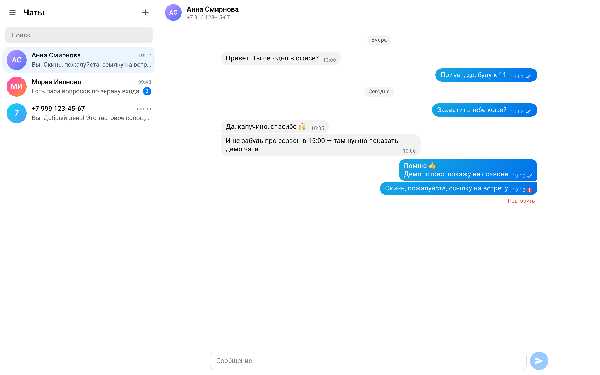

# Чат GREEN-API

Веб-интерфейс для отправки и получения текстовых сообщений в мессенджере через [GREEN-API](https://green-api.com). Тестовое задание на должность «Фронтенд разработчик React».

**Демо:** _ссылка появится после публикации_



## Мессенджер: Telegram вместо MAX

В личном кабинете GREEN-API при создании инстанса тариф для MAX был недоступен (предлагались только WhatsApp и Telegram). ТЗ разрешает этот случай, поэтому приложение сделано для **Telegram**.

У GREEN-API API для Telegram и MAX устроены одинаково: числовой `chatId`, поиск собеседника через `checkAccount`, те же методы отправки и получения. Поэтому приложение должно работать и с инстансом MAX без изменений кода. Проверить это на реальном инстансе MAX не удалось. Внешний вид по ТЗ повторяет [web.max.ru](https://web.max.ru): цвета, шрифт и радиусы взяты из его дизайн-системы.

## Как пользоваться

1. Введите `idInstance` и `apiTokenInstance` из [личного кабинета](https://console.green-api.com).
2. Нажмите «+» и введите номер телефона собеседника.
3. Напишите сообщение и нажмите Enter.
4. Ответ собеседника появится в чате автоматически.

## Возможности

- Вход по данным инстанса. Если `idInstance` или `apiTokenInstance` неверны, или инстанс не авторизован, показывается понятная ошибка.
- Чат по номеру телефона: поле с маской и выбором страны; вставка номера в виде «8 (999) …» приводится к +7.
- Отправка и получение текстовых сообщений. Enter отправляет, Shift+Enter переносит строку, длина сообщения ограничена 4000 символами.
- Статусы исходящих: отправляется → отправлено → прочитано, а при ошибке появляется «Повторить». Открытый чат отмечается прочитанным у собеседника.
- Список чатов: последнее сообщение, время, счётчик непрочитанных, поиск.
- Сессия и история сохраняются после перезагрузки страницы.
- Корректная работа в нескольких вкладках и при потере сети.
- Адаптивная вёрстка: на телефоне показывается либо список чатов, либо переписка.

## Подготовка инстанса GREEN-API

1. Создайте инстанс Telegram (тариф Developer бесплатный) и авторизуйте его по QR: в Telegram откройте «Настройки → Устройства → Подключить устройство».
2. В настройках инстанса:
   - поле **Webhook URL** оставьте пустым, иначе HTTP API не отдаёт уведомления;
   - включите уведомления о входящих сообщениях, исходящих сообщениях (с телефона и через API), статусах сообщений и состоянии инстанса.
3. У собеседника номер должен быть доступен для поиска: «Конфиденциальность → Номер телефона → Кто может найти меня по номеру → Все». Иначе `checkAccount` не найдёт аккаунт.

Если входящие уведомления выключены, приложение покажет предупреждение после входа.

## Запуск локально

Требования: Node.js ≥ 20.19 и pnpm.

```bash
pnpm install
pnpm dev        # http://localhost:5173
```

| Команда                        | Что делает                                                |
| ------------------------------ | --------------------------------------------------------- |
| `pnpm build` / `pnpm preview`  | production-сборка и её локальный просмотр                 |
| `pnpm test`                    | модульные и компонентные тесты (Vitest + Testing Library) |
| `pnpm lint` / `pnpm typecheck` | oxlint и проверка типов                                   |
| `pnpm format`                  | Prettier                                                  |

Сайт на GitHub Pages публикуется через GitHub Actions ([deploy.yml](.github/workflows/deploy.yml)) при каждом push в `main`. Перед публикацией workflow прогоняет линтер, проверку типов и тесты.

## Архитектура

```
src/
  api/          клиент GREEN-API: сборка URL, таймауты, ошибки → понятные тексты
  store/        состояние (useReducer + Context), сохранение в localStorage, синхронизация вкладок
  hooks/        сессия, цикл получения уведомлений, действия с чатами, автопрокрутка
  utils/        разбор уведомлений, телефоны, даты, аватары
  components/
    FormVerify/          вход
    PopupCreateContact/  новый чат по номеру
    Chat/                Sidebar + ChatHeader + MessageList + MessageInput
```

Компоненты только отображают данные и вызывают действия. Вся логика вынесена в `api/`, `store/` и `hooks/` и покрыта тестами.

### Получение сообщений

Используется HTTP API с long polling:

```
receiveNotification (ждёт до 20 с) → обработка → deleteNotification → снова
```

- **Удаление уведомлений.** Из очереди удаляется **каждое** полученное уведомление, даже ненужное. Иначе очередь «застревает» на нём.
- **Повторная доставка безопасна:** reducer идемпотентен, повторное сообщение с тем же `idMessage` игнорируется.
- **Ошибки сети и сервера:** повтор с нарастающей задержкой от 1 до 30 секунд.
- **Пропала сеть:** текущий запрос сразу прерывается, и цикл ждёт события `online`.
- **Несколько вкладок.** Очередь общая для всех вкладок, поэтому её читает только одна, выбранная через [Web Locks API](https://developer.mozilla.org/docs/Web/API/Web_Locks_API). Остальные получают изменения через `BroadcastChannel`. Если закрыть эту вкладку, опрос подхватывает следующая.

### Почему `checkAccount` перед отправкой

В Telegram и MAX `chatId` — это числовой ID пользователя, а не номер телефона. Отправить сообщение на `79991234567@c.us` можно, но ответ придёт с числовым `chatId` и не сопоставится с чатом. Поэтому при создании чата номер сначала превращается в `chatId` через `checkAccount`; результат кэшируется.

### Дедупликация отправленных сообщений

1. Отправленное сообщение сразу показывается с локальным id.
2. Ответ `sendMessage` заменяет локальный id на `idMessage`.
3. Эхо `outgoingAPIMessageReceived` с тем же `idMessage` дубля не создаёт, даже если пришло раньше ответа `sendMessage`.

## Тестирование

- **`pnpm test`** — модульные и компонентные тесты. Покрывают:
  - API-клиент;
  - разбор уведомлений;
  - reducer;
  - цикл опроса (задержки при ошибках, offline);
  - компоненты;
  - сквозной сценарий «создать чат → отправить → получить ответ»;
  - работу нескольких вкладок.
- **[`e2e/`](e2e/)** — прогон 13 пользовательских сценариев в настоящем Chrome против mock-сервера GREEN-API с очередью уведомлений. Проверяет:
  - неверный токен;
  - отправку, статусы и ответы;
  - перезагрузку страницы;
  - потерю и восстановление сети;
  - две вкладки;
  - мобильную ширину.

  Запуск описан в начале `e2e/run.mjs`.

## Ограничения

- **Токен хранится в `localStorage` браузера.** Для тестового задания без бэкенда это допустимо. В продакшене запросы к GREEN-API стоит проксировать через свой сервер.
- **Вкладки согласуют опрос только внутри одного браузера.** Если открыть чат одновременно в разных браузерах, они будут делить одну очередь уведомлений.
- **История хранится локально.** Переписка, которая была до первого входа, не загружается.
- **Только текстовые сообщения, как требует ТЗ.** Остальные типы сообщений показываются заглушкой.

## Что можно улучшить

- Загрузка истории через `getChatHistory`.
- Создание чата по `@username`.
- Виртуализация длинных переписок.
- Тёмная тема.
- Бэкенд с webhook вместо long polling.
